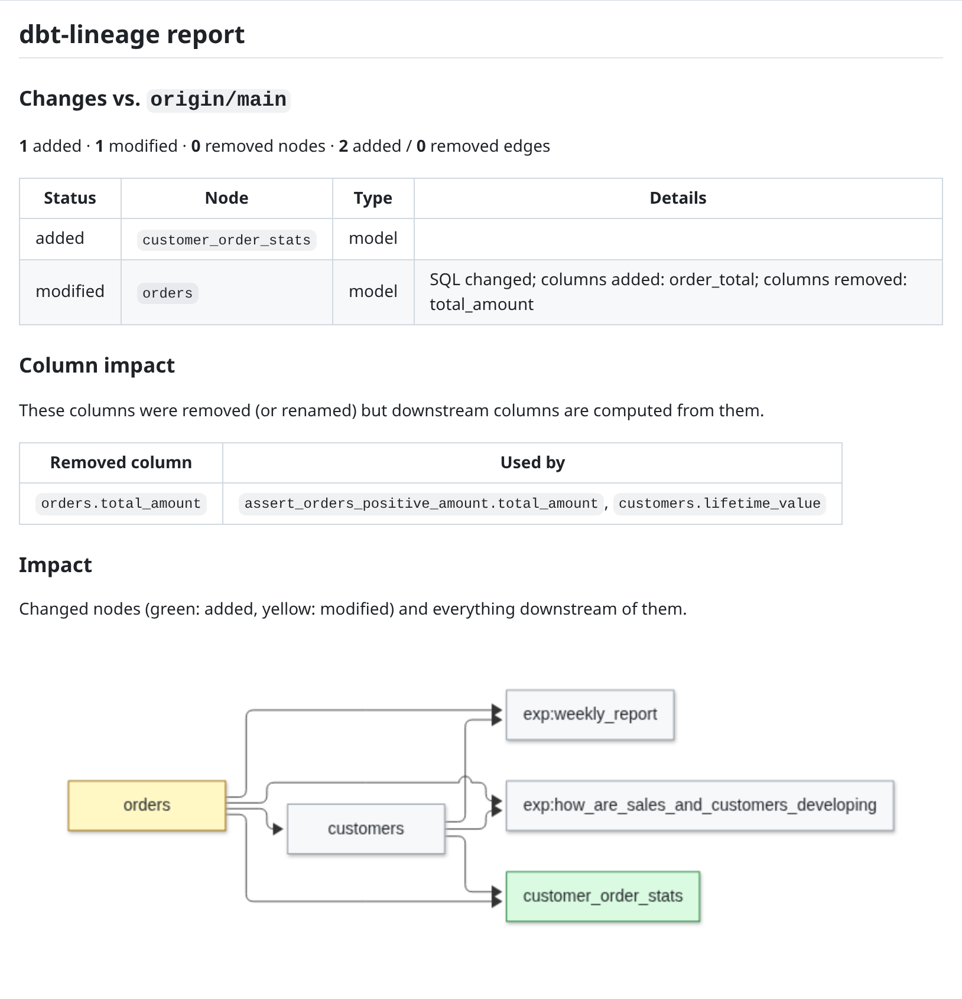
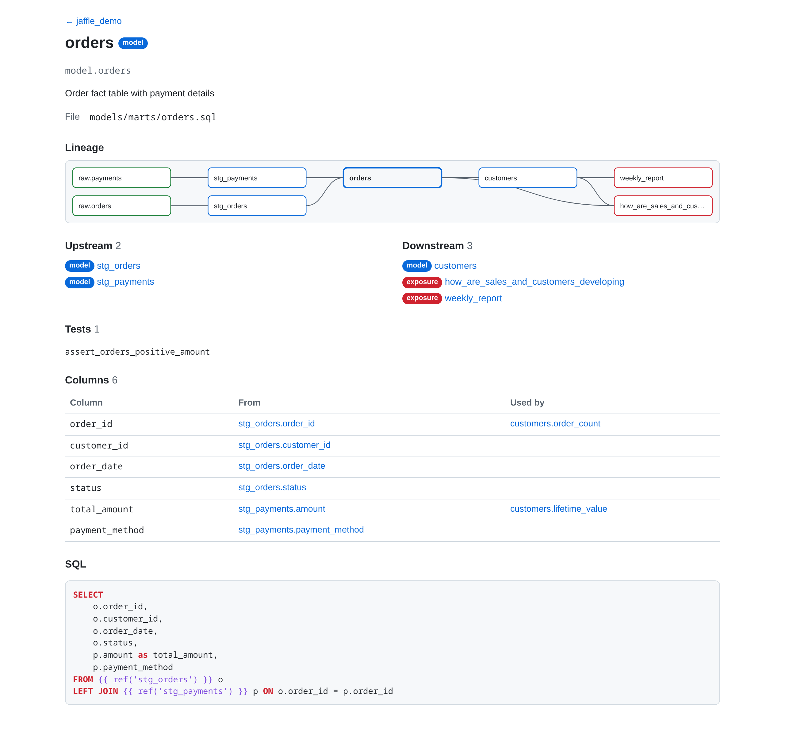

# dbt-lineage

[](https://github.com/sipemu/dbt-lineage-viewer/actions/workflows/ci.yml)
[](https://crates.io/crates/dbt-lineage)
[](https://docs.rs/dbt-lineage)
[](https://codecov.io/gh/sipemu/dbt-lineage-viewer)

<p align="center">
  <a href="https://github.com/sipemu/dbt-lineage-demo/pull/1">
    
  </a>
  <br>
  <sub>Every dbt PR gets one comment: what changed, which downstream columns and dashboards it breaks, and what to rebuild. <a href="https://github.com/sipemu/dbt-lineage-demo/pull/1">Live demo →</a></sub>
</p>

**See what a dbt change breaks — downstream models, columns, dashboards and contracts — before it ships.** dbt-lineage parses your project directly (no warehouse, no Python, no `dbt compile`) and puts lineage and impact wherever you work.

## Use it where you work

| Where | What you get | Get it |
| --- | --- | --- |
| **Pull requests** (GitHub) | One sticky comment per PR: lineage diff, column impact, affected dashboards, breaking changes, rebuild selector; inline lint annotations | [`uses: sipemu/dbt-lineage-viewer@v0`](#as-a-github-action) · [live demo](https://github.com/sipemu/dbt-lineage-demo/pull/1) |
| **GitLab · Bitbucket · Azure DevOps** | The same report as an MR/PR comment, plus Code Quality / Code Insights / build warnings | [`docs/CI.md`](docs/CI.md) |
| **VS Code, Cursor, VSCodium** | *Show impact of my changes* panel, hover and go-to-definition on `ref()`/`source()`, lint diagnostics; binary bundled | [VS Code Marketplace](https://marketplace.visualstudio.com/items?itemName=sipemu.dbt-lineage-viewer) · [Open VSX](https://open-vsx.org/extension/sipemu/dbt-lineage-viewer) |
| **Terminal** | Lineage, impact, diff, plan, lint, coverage, interactive TUI | `pip install dbt-lineage-cli` · `brew install sipemu/tap/dbt-lineage` · `cargo binstall dbt-lineage` |
| **Browser** | Static lineage site with column lineage for GitHub/GitLab Pages | [`dbt-lineage site`](#static-lineage-site) · [demo site](https://sipemu.github.io/dbt-lineage-demo/) |
| **BI tools** | Dashboards from Metabase, Tableau, Looker, Power BI, Superset and anofox-visualization as dbt exposures | [`dbt-lineage exposures <tool>`](docs/BI.md) |
| **AI agents** | MCP server with lineage, impact and column-lineage tools | [`dbt-lineage mcp`](#mcp-server) |
| **Neovim, Helix** | Language server (`dbt-lineage lsp`) | [`docs/EDITORS.md`](docs/EDITORS.md) |

## Features

### Source modes

- **Direct SQL parsing** — extracts `ref()` and `source()` via a Jinja-aware lexer, no `dbt compile` needed
- **Manifest support** — optionally read `manifest.json` for column metadata, materializations, and full graph fidelity
- **Jinja-aware dependencies** — finds `ref()`/`source()` anywhere in Jinja (``, `dbt_utils.star(from=ref('a'))`, versioned refs), follows macros that reference models (project and installed packages, including `adapter.dispatch`), and expands loops over literal lists. Check it on your project with [`verify`](#verify-lineage-against-dbt); see [Accuracy](#accuracy)
- **Parallel parsing + on-disk cache** — [`rayon`](https://crates.io/crates/rayon)-parallelized parsing and a content-hash cache at `.dbt-lineage/cache.bin`; warm runs are near-instant on large monorepos. Bypass with `--no-cache`. See [`docs/CACHE.md`](docs/CACHE.md)

### Analysis subcommands

- **`summary`** — one-shot project overview (counts, tags, top fan-out, orphans)
- **`impact <model>`** — downstream impact with severity scoring (Critical / High / Medium / Low)
- **`diff --base <ref>`** — compares lineage between git refs, showing added / removed / modified nodes and edges
- **`plan --base <ref>`** — emits a dbt selector for the minimal rebuild set; pipes into `dbt run -s "$(…)"`
- **`coverage`** — tests-per-model + per-column map; text, JSON, or SARIF (PR annotations)
- **`lint`** — flags unused sources, undefined refs, dead-end models, missing descriptions, models with only unresolved upstream, circular refs
- **`site`** — static lineage site (search, per-node pages with lineage diagram, column-level lineage, SQL) for GitHub/GitLab Pages
- **`docs`** — generates per-model Markdown with description, upstream / downstream, columns, embedded Mermaid lineage
- **`perf`** — joins `run_results.json` with the DAG: slowest models, critical paths
- **`verify`** — compares parsed lineage with dbt's `manifest.json` and lists every dependency that differs; exits non-zero when parsing missed one
- **`check-manifest`** — flags drift between `manifest.json` and current SQL files using dbt's recorded SHA-256 (mtime fallback); exits non-zero for CI gating

### Column-level lineage

- AST-backed analyzer via [`sqlparser`](https://crates.io/crates/sqlparser) (0.6.0+) handles aliases, JOINs, aggregations, and CTEs with proper transformation classification (`Direct`, `Aliased`, `Derived`)
- Regex-based analyzer remains as a fallback for dialect-specific syntax sqlparser can't yet parse

### MCP server (AI-agent integration)

- **`dbt-lineage mcp`** — stdio Model Context Protocol server. See [`docs/MCP.md`](docs/MCP.md) for setup and cookbook.
- **10 tools**: `summary`, `search_models`, `lineage`, `impact`, `get_model_details`, `read_model_sql`, `column_upstream`, `column_downstream`, `lineage_bundle`, `propose_test`
- **Resources**: model SQL, focused lineage diagrams, source/exposure metadata, always-fresh summary
- **Prompts**: `review-impact`, `propose-tests`, `explain-column`, `find-bottleneck`, `document-model`, `onboard-project`

### Output

- **6 formats** — ASCII, Graphviz DOT, JSON, Mermaid, self-contained SVG, interactive HTML (pan / zoom / search)
- **Mermaid niceties** — `--show-columns` inlines column names in node labels; `--group-by directory` emits Mermaid subgraphs
- **Graph collapse** — `--collapse` / `--collapse=focal` drops intermediate nodes and labels transitive paths with `(via N)` edges
- **Structured errors** — `--error-format json` writes `{level, what, why, hint}` to stderr for deterministic agent / CI consumers

### Editor integration

- **`dbt-lineage lsp`** — language server: hover and go-to-definition on `ref()` / `source()`, lineage code lens per model, lint diagnostics. VS Code extension on the [Marketplace](https://marketplace.visualstudio.com/items?itemName=sipemu.dbt-lineage-viewer) and [Open VSX](https://open-vsx.org/extension/sipemu/dbt-lineage-viewer) (`code --install-extension sipemu.dbt-lineage-viewer`); Neovim and Helix setup in [`docs/EDITORS.md`](docs/EDITORS.md)

### Interactive TUI


- Navigate, search, and explore lineage in a terminal UI ([`ratatui`](https://crates.io/crates/ratatui)) with Unicode box-drawing nodes, orthogonal edge routing, and full mouse support
- **Run dbt from TUI** — execute `dbt run` / `dbt test` on selected models with scope control (`+upstream`, `downstream+`, `+all+`) via keyboard menu or right-click context menu
- **Run status tracking** — color-coded nodes show success (green), error (red), outdated (yellow), or never-run (default)
- **Path highlighting** — trace upstream / downstream paths with impact analysis

### Filtering and node types

- **Selector expressions** — `-s tag:finance,path:marts` filters by tag, path, or model name (comma-separated)
- **Node-type filters** — `--include-tests`, `--include-seeds`, `--include-snapshots`, `--include-exposures`
- **Node-type support** — models, sources, seeds, snapshots, tests, exposures

## Accuracy

dbt-lineage reads dependencies from your SQL without running dbt, so it can
miss dependencies that only exist once Jinja is rendered. `dbt-lineage verify`
measures that on your own project against a `manifest.json` from `dbt parse`.

Results on public dbt projects (manifests from `dbt parse`, dbt Core 1.12 with
the DuckDB adapter; packages measured through their `integration_tests`
project). [`scripts/accuracy/run.py`](scripts/accuracy/run.py) produces this
table, and CI runs it on every parser change and weekly, failing on any missed
dependency:

<!-- accuracy:start -->
| Project | Models compared | Dependencies found | Extra, not in manifest |
| --- | ---: | ---: | ---: |
| [jaffle-shop](https://github.com/dbt-labs/jaffle-shop) `5beb145` | 13 | 17 / 17 | 0 |
| [tuva](https://github.com/tuva-health/tuva) `465927a` | 555 | 1,560 / 1,560 | 5 |
| [cal-itp data-infra](https://github.com/cal-itp/data-infra) `3801da6` | 625 | 1,192 / 1,192 | 0 |
| [Fivetran dbt_hubspot](https://github.com/fivetran/dbt_hubspot) `5f00935` | 176 | 280 / 280 | 18 |
| [Fivetran dbt_jira](https://github.com/fivetran/dbt_jira) `1a9f8b4` | 61 | 108 / 108 | 0 |
| [Fivetran dbt_shopify](https://github.com/fivetran/dbt_shopify) `a033782` | 240 | 414 / 414 | 25 |
| [Fivetran dbt_quickbooks](https://github.com/fivetran/dbt_quickbooks) `0b9da0d` | 114 | 210 / 210 | 35 |
| [Fivetran dbt_netsuite](https://github.com/fivetran/dbt_netsuite) `e3c026e` | 106 | 183 / 183 | 7 |
| [Fivetran dbt_zendesk](https://github.com/fivetran/dbt_zendesk) `c5f2cfa` | 88 | 162 / 162 | 6 |
| [Fivetran dbt_stripe](https://github.com/fivetran/dbt_stripe) `7f5d6ae` | 65 | 117 / 117 | 2 |
| [Fivetran dbt_salesforce](https://github.com/fivetran/dbt_salesforce) `8f9e9c0` | 24 | 42 / 42 | 1 |
<!-- accuracy:end -->

Every extra dependency sits in a Jinja branch switched off by the project's
current vars (``). dbt records only the
branches it renders; dbt-lineage keeps them so impact analysis doesn't miss a
dependency that a var can switch on.

What parsing can't follow: refs whose names are computed at render time from
variables or macro return values. `verify` lists those, and any command reads
`--manifest` for exact lineage when you need it.

### Column lineage

Column impact ("removing `stg_orders.customer_id` breaks `orders.customer_id`")
is measured the same way against a reference: [sqlglot](https://github.com/tobymao/sqlglot)
column lineage over the SQL dbt compiled after `dbt seed` and `dbt run` on
DuckDB ([`scripts/accuracy-columns/`](scripts/accuracy-columns)). CI re-runs
it alongside the model check and fails when a number drops below its
baseline.

| Project | From SQL alone | Precision | With compiled SQL + catalog | Precision |
| --- | ---: | ---: | ---: | ---: |
| jaffle-shop | 87 / 87 | 100% | 87 / 87 | 100% |
| tuva | 10,359 / 12,143 | 99% | 12,141 / 12,143 | 100% |
| Fivetran dbt_hubspot | 2,146 / 2,337 | 97% | 2,337 / 2,337 | 100% |
| Fivetran dbt_jira | 713 / 971 | 98% | 971 / 971 | 99% |
| Fivetran dbt_shopify | 5,109 / 5,436 | 98% | 5,436 / 5,436 | 100% |
| Fivetran dbt_quickbooks | 2,055 / 2,993 | 99% | 2,993 / 2,993 | 100% |
| Fivetran dbt_netsuite | 1,118 / 1,831 | 98% | 1,800 / 1,831 | 99% |
| Fivetran dbt_zendesk | 1,553 / 1,665 | 99% | 1,653 / 1,665 | 100% |
| Fivetran dbt_stripe | 1,576 / 1,816 | 96% | 1,809 / 1,816 | 100% |
| Fivetran dbt_salesforce | 661 / 719 | 76% | 719 / 719 | 100% |

From SQL alone, columns of models written in SQL are traced completely,
through CTEs, subqueries, joins, unions and `select *`. Where Jinja writes
the SELECT (loops, macros producing column lists or whole queries, as in
Fivetran's packages), dbt-lineage renders the model the way `dbt compile`
would, without dbt or a warehouse: the project's and installed packages'
macros (`dbt_packages/`, with `adapter.dispatch`), `vars`, and the columns it
already knows for each upstream relation (YAML, seed headers, upstream
models) answering `adapter.get_columns_in_relation`. What stays out of reach
offline: macros that read data (`run_query`, pivots over
`dbt_utils.get_column_values`) and `select *` from sources whose columns YAML
doesn't declare; the catalog closes most of that gap.

**With dbt artifacts:** when `target/manifest.json` holds dbt's compiled SQL
(from `dbt compile` or `dbt run`), column lineage reads it for every model
whose file still matches the checksum dbt recorded, so an outdated manifest
never stands in for edited code. `target/catalog.json` (from `dbt docs
generate`) adds the warehouse's actual columns, so `select *` from a source
expands to columns YAML doesn't declare. For PR column impact, give `ci
report` the base branch's manifest too (`--base-manifest`, e.g. the
production manifest many teams keep for slim CI) and run `dbt compile` in the
PR job; with compiled SQL on one side only, both sides use raw SQL so the
before/after columns are inferred the same way.

Where Jinja decides lineage at render time, the PR comment says so: a
**Lineage may be incomplete** section lists the affected models on the
impact path and why (a `ref()` with computed arguments, or columns written by
a loop or macro), so a short impact list isn't mistaken for a complete one.

## Compared with dbt's own tools

dbt Labs' new engine (dbt v2, formerly "Fusion", [GA since September
2026](https://docs.getdbt.com/blog/dbt-v2-is-ga)) also understands SQL
statically, and its [VS Code extension](https://docs.getdbt.com/docs/about-dbt-extension)
shows table-level lineage while you edit, and column-level lineage in strict
mode. They solve different parts of the problem; as of November 2026:

| | dbt-lineage | dbt v2 + VS Code extension | dbt platform Advanced CI |
| --- | --- | --- | --- |
| Downstream impact as a PR/MR comment | GitHub, GitLab, Bitbucket, Azure DevOps | – | PR comment summarising a **data** diff; Enterprise plans |
| Needs warehouse access | no | not for parsing; column lineage needs `static_analysis: strict` and upstream schemas | yes, builds the PR in the warehouse |
| Projects | dbt Core 1.x and v2 projects, any adapter | projects migrated to v2 (deprecations fixed); BigQuery, Databricks, Redshift, Snowflake, DuckDB and Spark on the CLI | BigQuery, Databricks, Postgres, Redshift, Snowflake |
| License | MIT | dbt OSS is Apache 2.0; the full engine, LSP and extension are proprietary (free, no login) | commercial |

Sources: [supported features](https://docs.getdbt.com/docs/dbt/supported-features),
[new concepts](https://docs.getdbt.com/docs/fusion/new-concepts),
[Advanced CI](https://docs.getdbt.com/docs/deploy/advanced-ci),
[licensing FAQ](https://www.getdbt.com/licenses-faq).

The two combine well: dbt's extension for type checking while you write SQL,
dbt-lineage for reviewing what a pull request breaks downstream, on any CI.

## Installation

### From crates.io

```sh
cargo install dbt-lineage
```

### pip / uv (no Rust needed)

```sh
pip install dbt-lineage-cli          # installs the `dbt-lineage` command
uvx --from dbt-lineage-cli dbt-lineage --help
```

### Homebrew (macOS, Linux)

```sh
brew install sipemu/tap/dbt-lineage
```

### With cargo-binstall (no compile)

```sh
cargo binstall dbt-lineage
```

### Pre-built binaries

Every tagged release ships pre-built binaries for Linux (x86_64 + aarch64), macOS (Intel + Apple Silicon), and Windows (x86_64) as downloadable assets on the [Releases page](https://github.com/sipemu/dbt-lineage-viewer/releases). Download the archive for your platform, extract, and put the binary on your `PATH`.

### As a GitHub Action

**Live demo:** [sipemu/dbt-lineage-demo#1](https://github.com/sipemu/dbt-lineage-demo/pull/1) shows the PR comment (lineage diff with SQL body changes, column impact, Mermaid impact diagram, rebuild selector, lint); [sipemu.github.io/dbt-lineage-demo](https://sipemu.github.io/dbt-lineage-demo/) is the same project as a `dbt-lineage site`.

```yaml
on: pull_request

permissions:
  contents: read
  pull-requests: write    # sticky PR comment
  security-events: write  # only needed with `sarif:`

jobs:
  lineage:
    runs-on: ubuntu-latest
    steps:
      - uses: actions/checkout@v5
        with:
          fetch-depth: 0  # `diff` / `plan` need the base branch history
      - uses: sipemu/dbt-lineage-viewer@v0
        with:
          base: ${{ github.base_ref }}  # e.g. main; resolved to origin/main if needed
          project-dir: dbt/
          comment: true                 # post a Markdown summary as a PR comment
          sarif: lint,coverage          # also surface findings as PR annotations
```

`@v0` tracks the latest `0.x` release; pin an exact tag (e.g. `@v0.9.1`) if you prefer. The action installs the matching `dbt-lineage` binary from this repo's release artifacts, runs `summary`, `diff`, `plan`, and optionally `lint`/`coverage` SARIF, then posts a single sticky comment on the PR with the rendered report. See [`action.yml`](action.yml) for the full input/output reference.

To check dbt-lineage against dbt on your own project in every PR, run `dbt parse` first (it needs your `profiles.yml` but never connects to the warehouse) and set `verify: true`; the comment then reports how much of dbt's lineage was found, and `fail-on: verify-missed` fails the check when a dependency was missed:

```yaml
      - run: pip install dbt-core dbt-snowflake && dbt parse   # your adapter; no connection made
      - uses: sipemu/dbt-lineage-viewer@v0
        with:
          verify: true
          fail-on: lint-errors,verify-missed
```

### Container image

```sh
docker run --rm -v "$PWD:/workspace" ghcr.io/sipemu/dbt-lineage:latest summary
```

Published to `ghcr.io/sipemu/dbt-lineage` on every release (`latest`, `v0`, `0.x`, `0.x.y`; amd64 + arm64), with `git` included for `diff` / `plan` / `ci report`. In GitLab CI, override the entrypoint:

```yaml
dbt-lineage:
  image: { name: ghcr.io/sipemu/dbt-lineage:v0, entrypoint: [""] }
  script: dbt-lineage ci report --out report.md
```

### As a pre-commit hook

```yaml
# .pre-commit-config.yaml in your dbt repo
repos:
  - repo: https://github.com/sipemu/dbt-lineage-viewer
    rev: v0.18.0
    hooks:
      - id: dbt-lineage-lint
      - id: dbt-lineage-check-manifest   # needs a compiled target/manifest.json
        args: [-p, path/to/dbt]          # only if the project isn't at the repo root
```

### From source

```sh
git clone https://github.com/sipemu/dbt-lineage-viewer.git
cd dbt-lineage-viewer
cargo install --path .
```

The binary is installed to `~/.cargo/bin/dbt-lineage`.

## Usage

### Static output

```sh
# Full lineage of current directory's dbt project
dbt-lineage

# Focus on a specific model
dbt-lineage stg_orders

# Point at a different project directory
dbt-lineage -p path/to/dbt/project

# Show 2 levels upstream, 1 downstream
dbt-lineage stg_orders -u 2 -d 1

# Include seeds, tests, snapshots, exposures
dbt-lineage --include-seeds --include-tests --include-snapshots --include-exposures

# Selector expressions
dbt-lineage -s tag:finance,path:marts

# Use manifest.json instead of parsing SQL
dbt-lineage --manifest target/manifest.json

# Output formats
dbt-lineage -o dot > lineage.dot        # Graphviz DOT
dbt-lineage -o json                      # JSON graph
dbt-lineage -o mermaid                   # Mermaid diagram
dbt-lineage -o svg > lineage.svg         # Self-contained SVG
dbt-lineage -o html > lineage.html       # Interactive HTML (pan/zoom/search)
```

### Interactive TUI

```sh
dbt-lineage -i
dbt-lineage -i -p path/to/dbt/project
dbt-lineage -i stg_orders -u 3 -d 3
```

### Breaking changes to governed models

`diff`, `ci report` and the PR comment flag changes that break consumers of governed models (dbt 1.5+ model governance in schema YAML):

- contracted models (`config: {contract: {enforced: true}}`): a contract column removed or its `data_type` changed, or the contract dropped;
- `access` narrowed (`public` → `protected` → `private`);
- a model version (`versions:`) or a governed model removed.

`ci report --fail-on breaking-changes` fails the check. `lint` adds a `private-ref` error for refs to `access: private` models from outside their `group`, which dbt rejects at parse time.

### Impact analysis

Compute downstream impact for a model with severity scoring:

```sh
dbt-lineage impact orders -p path/to/project          # text report
dbt-lineage impact orders -o json                      # JSON for CI
dbt-lineage impact orders --manifest target/manifest.json
```

Severity levels:
- **Critical** — impacts exposures (dashboards, reports)
- **High** — impacts table/incremental materializations or mart models
- **Medium** — impacts staging or intermediate models
- **Low** — impacts tests only

### Lineage diff

Compare lineage between git refs to see what changed:

```sh
dbt-lineage diff --base main                           # compare main to working tree
dbt-lineage diff --base main --head feature-branch     # compare two branches
dbt-lineage diff --base HEAD~1 -o json                 # JSON for CI integration
```

Shows added, removed, and modified nodes and edges with a summary of changes.

### Static lineage site

A self-contained static site — search, one page per model/source/seed/exposure with its lineage diagram, columns with column-level lineage, and highlighted SQL — ready for GitHub or GitLab Pages:

```sh
dbt-lineage site -p path/to/project --out site
```

<a href="https://sipemu.github.io/dbt-lineage-demo/nodes/model.orders.html"></a>

Light/dark, phone-friendly, no server or CDN. See [`docs/SITE.md`](docs/SITE.md) for Pages workflows.

### Project summary

One-shot project overview, designed as the first thing an agent (or human) runs against an unfamiliar dbt project:

```sh
dbt-lineage summary -p path/to/project                 # text
dbt-lineage summary --manifest target/manifest.json    # manifest mode
dbt-lineage summary -o json                            # structured for piping into jq
```

Reports counts per node type, tag distribution, top downstream-reach models, and orphan models (no downstream consumers).

### BI dashboards as exposures

Generate dbt exposures from Metabase, anofox-visualization, Tableau, Looker, Superset or Power BI dashboards, so impact analysis knows which dashboards a change reaches:

```sh
METABASE_API_KEY=mb_… dbt-lineage exposures metabase --url https://metabase.example.com \
  --write models/exposures_metabase.yml
```

From a LookML project, offline (LookML dashboards → explores → views → tables):

```sh
dbt-lineage exposures looker --lookml path/to/lookml-project --write models/exposures_looker.yml
```

From [anofox-visualization](https://github.com/DataZooDE/anofox-visualization) dashboards (DuckDB `.sql` files with `::ROLE` panels):

```sh
dbt-lineage exposures anofox --dashboards dashboards/ --url 'https://viz.example.com/d/{name}' \
  --write models/exposures_anofox.yml
```

From Tableau workbooks, offline (`.twb` / `.twbx`):

```sh
dbt-lineage exposures tableau --workbooks workbooks/ --write models/exposures_tableau.yml
```

From Superset dashboard exports, offline (ZIPs from `superset export-dashboards` or the UI; dashboard → charts → datasets → tables, virtual-dataset SQL included):

```sh
dbt-lineage exposures superset --exports exports/ \
  --url 'https://superset.example.com/superset/dashboard/{name}/' --write models/exposures_superset.yml
```

From Power BI, offline: PBIP projects (`*.Report` + `*.SemanticModel`, TMDL or `model.bim`) and `.pbit` templates; tables come from the partitions' Power Query (M) sources and native SQL:

```sh
dbt-lineage exposures powerbi --reports powerbi/ --url 'https://app.powerbi.com/groups/me/reports/{name}' \
  --write models/exposures_powerbi.yml
```

Tables the dashboards read are mapped onto models and sources; unmatched tables are listed on stderr. See [`docs/BI.md`](docs/BI.md).

### CI report

One Markdown report for PR/MR comments — lineage diff, rebuild selector, manifest freshness, lint, and project summary — plus exit codes for gating:

```sh
dbt-lineage ci report                                  # base = PR/MR target branch from CI env
dbt-lineage ci report --base main --out report.md      # explicit base, write to file
dbt-lineage ci report --fail-on lint-errors,plan-empty --outputs "$GITHUB_OUTPUT"
```

`--base auto` (default) reads the target branch from GitHub Actions, GitLab CI, Bitbucket Pipelines or Azure Pipelines, and resolves it as `origin/<branch>` (fetching it if the checkout is shallow). `--outputs` appends `selector=…` and `failed=…` lines, usable as `$GITHUB_OUTPUT` or a GitLab dotenv report. `dbt-lineage ci comment --file report.md` posts it as one sticky PR/MR comment, and `dbt-lineage ci annotations --format sarif|codeclimate|bitbucket|azure` turns lint findings into inline annotations (Bitbucket Code Insights with `--post`). The GitHub Action, the GitLab component, the Bitbucket Pipe and the Azure Pipelines template are thin wrappers around these commands; see [`docs/CI.md`](docs/CI.md).

### Verify lineage against dbt

Measure how closely parsed lineage matches dbt's own on your project:

```sh
dbt parse                                   # writes target/manifest.json, no warehouse queries
dbt-lineage verify -p path/to/project       # text; exit 1 if a dependency was missed
dbt-lineage verify -o json                  # every mismatch, plus recall/precision
```

`verify` compares the upstream models, seeds, snapshots and sources of every model in both graphs and lists dependencies dbt has that parsing missed, dependencies parsing found that dbt doesn't record (usually Jinja branches switched off by vars), and models only one side knows. Run it in CI next to `dbt parse` to keep SQL-parse mode honest on your project.

### Manifest freshness

CI-friendly drift check between a distributed `manifest.json` and current SQL files:

```sh
dbt-lineage check-manifest -p path/to/project           # text; exit 1 if stale
dbt-lineage check-manifest -o json                      # JSON for tooling
```

Flags three kinds of drift: SQL files referenced by the manifest that are now missing, files modified since the manifest was generated, and SQL files added but not yet compiled into the manifest.

### Graph collapse

Collapse intermediate nodes so big projects render as just their endpoints, with transitive paths labeled `(via N)`:

```sh
dbt-lineage --collapse -o mermaid                       # keep endpoints + focus model
dbt-lineage orders --collapse=focal -u 3 -o mermaid     # focal: only sources/exposures/focus
dbt-lineage --collapse -o json                          # JSON edges carry a via_hops field
```

Positional focus models (e.g. `dbt-lineage orders --collapse`) are always preserved even when they would otherwise be classified as intermediate.

### Mermaid options

```sh
dbt-lineage -o mermaid --show-columns                   # inline column names in node labels
dbt-lineage -o mermaid --group-by directory             # group nodes by directory via subgraph
dbt-lineage -o mermaid --show-columns --collapse        # combine: endpoint nodes with full column lists
```

### Structured errors for agents and CI

```sh
dbt-lineage --error-format json some_unknown_model
# stderr: {"level":"error","what":"model not found","why":"...","hint":"..."}
```

`--error-format json` writes one JSON object per line to stderr. `stdout` is unaffected, so piping into `jq` still works.

### Editor integration (language server)

`dbt-lineage lsp` serves the Language Server Protocol over stdio: hover and go-to-definition on `ref()` / `source()`, a code lens with upstream/downstream counts and impact on every model, and `lint` findings as diagnostics. Use the VS Code extension in [`editors/vscode`](editors/vscode), or point Neovim, Helix or any LSP client at `dbt-lineage lsp`. See [`docs/EDITORS.md`](docs/EDITORS.md).

### MCP server

Expose lineage as stdio MCP tools, resources, and prompts that Claude Code, Claude Desktop, and other MCP-aware clients can call directly:

```sh
claude mcp add dbt-lineage -- dbt-lineage mcp --project-dir /abs/path/to/project   # SQL-parse mode
claude mcp add dbt-lineage -- dbt-lineage mcp --manifest /abs/path/to/manifest.json # manifest mode
```

Works in both SQL-parse and manifest mode (`target/manifest.json` is picked up automatically when present). Tools: `summary`, `search_models`, `lineage`, `impact`, `get_model_details`, `read_model_sql`, `column_upstream`, `column_downstream`, `lineage_bundle`, `propose_test`; plus model resources and predefined prompts. MCP Registry name: `mcp-name: io.github.sipemu/dbt-lineage`. See [`docs/MCP.md`](docs/MCP.md) for client setup, prompt walkthroughs, and composition recipes.

## CLI Reference

Run `dbt-lineage <command> --help` for per-subcommand options.

```
Usage: dbt-lineage [OPTIONS] [MODEL] [COMMAND]

Commands:
  impact          Compute downstream impact analysis for a model
  summary         Print a one-shot project overview: counts, tags, top fan-out, orphans
  mcp             Run an MCP (Model Context Protocol) stdio server exposing lineage tools to AI agents. Reads JSON-RPC requests on stdin, writes responses to stdout
  lsp             Run a Language Server (stdio) for editors: hover and go-to-definition on ref()/source(), a lineage code lens per model, and lint diagnostics
  perf            Critical-path and slowest-model performance report from target/run_results.json
  macros          Show the macro call graph (macros calling other macros)
  site            Generate a static lineage site (search, one page per node with columns, column lineage, SQL and a lineage diagram) for GitHub/GitLab Pages
  docs            Generate Markdown documentation per model (or one consolidated file)
  lint            Structural lint: dead-end models, unused sources, undefined refs, missing docs. Exit code 1 if any error-severity finding is reported
  coverage        Test coverage map: which models have which tests, column coverage gaps
  check-manifest  Verify a manifest.json is still in sync with the project's SQL files. Exits with code 1 on staleness, making it directly usable in CI pipelines
  plan            Emit a dbt selector expression covering models added or modified since `--base`. Designed to pipe into `dbt run -s "$(dbt-lineage plan --base main)"`
  ci              CI integration: one Markdown report for PR/MR comments, plus exit codes for gating. Works on GitHub Actions, GitLab CI, Bitbucket Pipelines and Azure Pipelines
  exposures       Import BI dashboards as dbt exposures (YAML), mapping the tables they read onto the project's models and sources
  diff            Compare lineage between git refs
  help            Print this message or the help of the given subcommand(s)

Arguments:
  [MODEL]  Model name to focus on (shows full lineage if omitted)

Options:
  -p, --project-dir <PROJECT_DIR>    Path to dbt project directory [default: .]
  -u, --upstream <UPSTREAM>          Upstream levels to show (default: all)
  -d, --downstream <DOWNSTREAM>      Downstream levels to show (default: all)
  -i, --interactive                  Launch interactive TUI mode
  -o, --output <OUTPUT>              Output format: ascii (default), dot, json, mermaid, svg, html [default: ascii] [possible values: ascii, dot, json, mermaid, svg, html]
      --include-tests                Include test nodes
      --include-seeds                Include seed nodes
      --include-snapshots            Include snapshot nodes
      --include-exposures            Include exposure nodes
  -s, --select <SELECT>              Selector expression: tag:X, path:Y, or model name (comma-separated)
      --manifest <MANIFEST>          Use manifest.json instead of parsing SQL (path to manifest file or directory containing target/manifest.json)
      --show-columns                 Mermaid only: inline column names inside each node's label
      --group-by <GROUP_BY>          Mermaid only: group nodes by directory using Mermaid subgraphs [default: none] [possible values: none, directory]
      --error-format <ERROR_FORMAT>  How errors are written to stderr: human-readable text (default) or one JSON object per line (`{level, what, why, hint}`) for agent/CI consumers [default: plain] [possible values: plain, json]
      --collapse [<COLLAPSE>]        Drop intermediate nodes and replace transitive paths with `(via N)` edges. Bare `--collapse` is equivalent to `--collapse auto` (keep endpoints + focus); `--collapse focal` keeps only sources, exposures, and the focus model [default: none] [possible values: none, auto, focal]
      --no-cache                     Bypass the on-disk parse cache (.dbt-lineage/cache.bin). Useful when debugging parser changes or you want a clean baseline benchmark
  -h, --help                         Print help (see more with '--help')
  -V, --version                      Print version
```

## TUI Keybindings

### Navigation

| Key | Action |
|-----|--------|
| `h` `j` `k` `l` / arrow keys | Navigate between nodes (left/down/up/right) |
| `H` `J` `K` `L` | Pan the viewport |
| `+` / `-` | Zoom in / out (adjusts spacing) |
| `Tab` / `Shift+Tab` | Cycle through nodes sequentially |
| `r` | Reset view (center + zoom) |

### Mouse

| Action | Target | Effect |
|--------|--------|--------|
| Left click | Node on graph | Select node (no viewport jump) |
| Left click | Empty graph area | Begin drag to pan |
| Drag | Graph area | Pan the viewport |
| Scroll up / down | Graph area | Zoom in / out |
| Left click | Node list entry | Select node and center viewport |
| Left click | Group header | Collapse / expand group |
| Right click | Node on graph | Open context menu (run options) |

### Search

| Key | Action |
|-----|--------|
| `/` | Open search (fuzzy, powered by [nucleo](https://crates.io/crates/nucleo-matcher) — type any few characters in any order) |
| `Tab` | Next search result |
| `Esc` / `Enter` | Close search |

### Analysis

| Key | Action |
|-----|--------|
| `p` | Toggle path highlighting (upstream/downstream trace with impact analysis) |
| `C` (Shift+C) | Toggle column-level lineage in detail panel |
| `v` | Toggle in-app SQL viewer (syntax-highlighted SQL of the selected node) |
| `m` | Toggle minimap overlay (top-right corner of the graph area) |

### Node list panel

| Key | Action |
|-----|--------|
| `n` | Toggle node list sidebar |
| `c` | Collapse/expand directory group |

### Running dbt

| Key | Action |
|-----|--------|
| `x` | Open run menu for selected node |
| Right click | Open context menu on a node (same run options) |
| `o` | View last run output |

Run menu / context menu options:

| Key | Command |
|-----|---------|
| `r` | `dbt run` (this model) |
| `u` | `dbt run` +upstream |
| `d` | `dbt run` downstream+ |
| `a` | `dbt run` +all+ |
| `t` | `dbt test` |

### General

| Key | Action |
|-----|--------|
| `q` | Quit |
| `Ctrl+C` | Quit (any mode) |

## Node colors in TUI

**By run status** (when `target/run_results.json` exists):

| Color | Meaning |
|-------|---------|
| Green | Last run succeeded |
| Red | Last run failed |
| Yellow | Outdated (source file modified after last run) |
| DarkGray | Skipped |

**By node type** (when never run):

| Color | Type |
|-------|------|
| Blue | Model |
| Green | Source |
| Yellow | Seed |
| Magenta | Snapshot |
| Cyan | Test |
| Red | Exposure |
| DarkGray | Phantom (unresolved ref) |

## How it works

1. **Parse** `dbt_project.yml` to find model/seed/snapshot paths (or read `manifest.json`)
2. **Walk** those directories, collecting `.sql` and `.yml` files
3. **Extract** `ref('model')` and `source('schema', 'table')` from the Jinja in each SQL file (after a lexer blanks out comments and string literals), including calls inside macros the model uses and loops over literal lists
4. **Parse** YAML schema files for sources, model descriptions, and exposures
5. **Build** a directed acyclic graph (petgraph) where edges flow from dependency to dependent
6. **Resolve** column-level lineage by tracing SELECT/FROM/JOIN through the graph
7. **Filter** by focus model, depth, selectors, and node type
8. **Layout** using a Sugiyama-style layered algorithm (longest-path layering + barycenter ordering)
9. **Render** as ASCII, DOT, JSON, Mermaid, SVG, HTML, or interactive TUI

## uv / virtualenv support

When running dbt from the TUI, the tool auto-detects whether to use `uv run dbt` or plain `dbt`:

- If `uv.lock` or `pyproject.toml` exists in the dbt project directory, uses `uv run dbt`
- Otherwise, if `dbt` is on PATH, uses it directly
- If `dbt` is not on PATH but `uv` is, falls back to `uv run dbt`

## Building without TUI

The TUI is enabled by default. To build a minimal binary with only static output:

```sh
cargo build --release --no-default-features
```

## Further reading

- [`CHANGELOG.md`](CHANGELOG.md) — per-release notes from 0.1.0 onward.
- [`docs/MCP.md`](docs/MCP.md) — cookbook for the MCP server: setup, tool reference, prompt walkthroughs, composition recipes.
- [`docs/CACHE.md`](docs/CACHE.md) — parse-cache contract, file format, when it helps.
- [`BENCHMARKS.md`](BENCHMARKS.md) — baseline numbers from the bench harness.

## Credits

The agent-oriented additions in 0.3.0 — `summary`, `check-manifest`, `mcp`, `--collapse`, `--error-format json`, and the Mermaid `--show-columns` / `--group-by directory` options — were inspired by [eitsupi/dlin](https://github.com/eitsupi/dlin), a hard fork that focuses on non-interactive (CI/agent) workflows. dbt-lineage retains its TUI focus and brings these ideas back upstream.

## License

MIT
