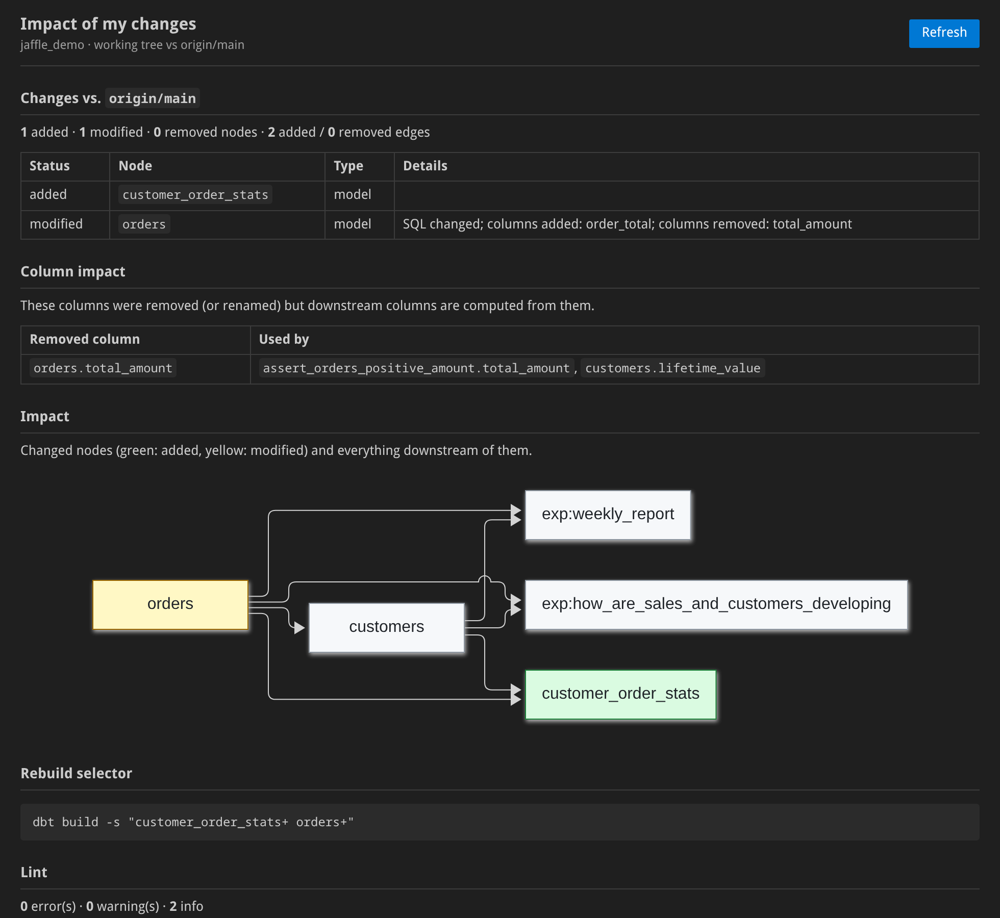

# dbt-lineage for VS Code

**See what your dbt change breaks before CI does.** One command compares your working tree with the main branch and shows the downstream models, columns, dashboards and contracts your edit affects, plus the `dbt build` selector that rebuilds exactly those.

Nothing else to install: the `dbt-lineage` binary ships inside the extension. It reads your SQL and YAML directly, so there is no warehouse connection, no Python and no `dbt compile`.

## Impact of my changes

Run **dbt-lineage: Show impact of my changes** from the command palette, or click **dbt impact** in the status bar. The panel shows:

- **Changes** against the base branch: added, modified and removed models, sources, seeds and exposures, with added and removed columns.
- **Column impact**: removed or renamed columns that downstream columns are still computed from.
- **Breaking changes** on governed models (contracts, `access`, versions).
- **Impact graph**: every changed node and everything downstream of it, down to exposures (dashboards).
- **Rebuild selector**: `dbt build -s "…"` for exactly the affected nodes.
- **Lint** findings for the project.

The report is the same one `dbt-lineage ci report` posts as a pull-request comment, so what you see locally is what reviewers will see. Turn on `dbtLineage.impactOnSave` to refresh it on every save.

## While you write SQL

- **Hover** on `ref('…')` / `source('…', '…')`: node type, materialization, description, upstream/downstream counts, and the impact if it changes.
- **Go to definition** on `ref()` → the model's SQL file; on `source()` → the table entry in its YAML.
- **Code lens** on every model: `N upstream · M downstream · impact: high`. Click it to open the lineage graph.
- **Diagnostics** from `dbt-lineage lint`: undefined refs and sources, dead-end models, missing descriptions. Refreshed on save.
- **dbt-lineage: Show lineage**: an interactive lineage graph of the current model in a side panel.

## Settings

| Setting | Default | Description |
| --- | --- | --- |
| `dbtLineage.baseRef` | `auto` | Branch or ref the impact report compares against. `auto`: the remote's default branch (`origin/HEAD`), else `main`, else `master` |
| `dbtLineage.impactOnSave` | `false` | Refresh the impact panel on save while it is open |
| `dbtLineage.path` | *(empty)* | Use your own `dbt-lineage` binary instead of the bundled one |
| `dbtLineage.lineageDepth` | `3` | Levels up and down shown by *Show lineage* |

## Notes

- The extension activates in workspaces containing a `dbt_project.yml`. Projects in subfolders are found per file, so monorepos with several projects work.
- The impact report needs the project to be in a git repository with the base branch available locally or as `origin/<branch>`.
- The graph is read from disk and rebuilt on save, so unsaved edits are not reflected until you save.
- Platform packages (bundled binary) exist for Linux x64/arm64, macOS Intel/Apple silicon and Windows x64. On other platforms the extension uses `dbt-lineage` from your `PATH` (`pip install dbt-lineage-cli`, `brew install sipemu/tap/dbt-lineage` or `cargo binstall dbt-lineage`).

Source, CLI and CI integrations: [github.com/sipemu/dbt-lineage-viewer](https://github.com/sipemu/dbt-lineage-viewer).
